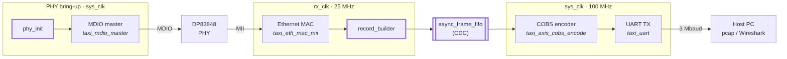
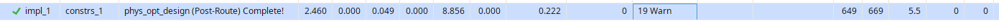
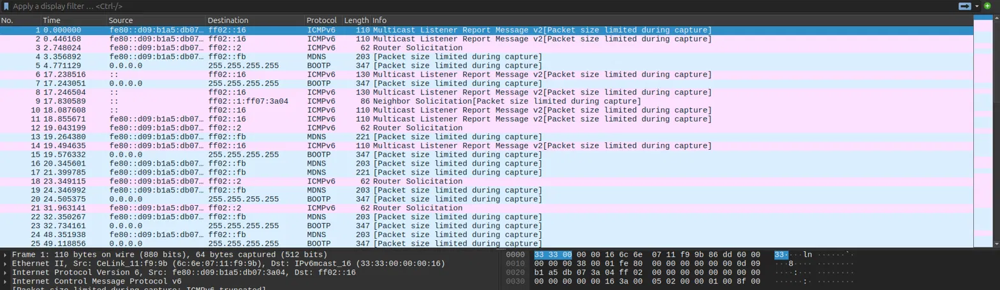

# FPGA Ethernet Sniffer

A receive-only 100BASE-TX packet capture engine for the Arty A7-100T,
written in SystemVerilog. Frames from the onboard PHY are timestamped,
truncated and sent over UART as capture records, which a small
Python tool turns into pcap for Wireshark.

**Block Diagram**


## Highlights

- **Custom dual-clock frame FIFO.** Gray-coded pointers, `ASYNC_REG`
  synchronisers, and commit/rollback frame semantics. Bad-FCS frames and
  frames that don't fit are dropped whole.
- **One-bit-per-cycle pointer crossing.** A commit jumps the write pointer by
  a whole frame, so a separate published pointer steps towards it one entry
  per cycle, and every pointer that crosses clock domains changes at most one bit
  per cycle.
- **Record builder in the PHY clock domain.** Timestamps each frame (48-bit,
  40 ns ticks), truncates it to a configurable snap length, and appends a
  trailer with the original length and a dropped-frame count.
- **AXI4-Stream throughout.** The write side runs at line rate with no
  backpressure, and backpressure from the UART is absorbed at the FIFO.
- **Verified with cocotb and Verilator** across six clock ratios with random
  phase, random backpressure, and line-rate bursts.

The Ethernet MAC, COBS encoder, UART, MDIO master and reset synchroniser come
from Alex Forencich's [Taxi](https://github.com/fpganinja/taxi) library. 
## Record format

One COBS-encoded record per frame, terminated by `0x00`. Fields are
little-endian.

| Field      | Bytes      | Description                                      |
|------------|------------|--------------------------------------------------|
| `ts`       | 6          | rx_clk ticks at the first byte (40 ns per tick)  |
| `data`     | ≤ SNAPLEN  | start of the frame, without FCS                  |
| `orig_len` | 2          | full frame length, without FCS                   |
| `drops`    | 2          | frames dropped since the previous record         |

## Repository layout

```
rtl/        record_builder, async_frame_fifo, sync_ff, phy_init, core and board top
constr/     pin, timing and CDC constraints
syn/        Vivado batch build
tb/         cocotb testbenches (Makefile flow)
host/       record decoder, pcap writer, capture CLI
lib/taxi/   Taxi library (git submodule)
```

**Requirements**
cocotb>=2.0
cocotbext-axi>=0.1.28
cocotbext-eth>=0.1.28
cocotbext-uart>=0.1.4
scapy>=2.6
pytest
pytest-xdist
pyserial

## Getting started

```bash
git clone --recursive <this repo>
# or, in an existing clone:
git submodule update --init
```

**Simulate.** Requires Verilator 5.050 or later and Python 3.10+.

```bash
pip install -r requirements.txt
make -C tb                     # all testbenches
make -C tb/test_top WAVES=1    # one bench, with an FST waveform
python -m pytest host/tests
```

**Build.** Requires Vivado.

```bash
cd syn && vivado -mode batch -source build.tcl   # bitstream in syn/out/
```

**Capture.** Connect the Arty's Ethernet port to the monitor port of a passive
10/100 tap.

```bash
python -m sniffer.cli -p /dev/ttyUSB1 -w capture.pcap
python -m sniffer.cli -p /dev/ttyUSB1 | wireshark -k -i -
```
**FPGA Stats**



**Wireshark Demo**



## Acknowledgements

Built on [Taxi](https://github.com/fpganinja/taxi) by Alex Forencich, which is
licensed under CERN-OHL-S 2.0.
